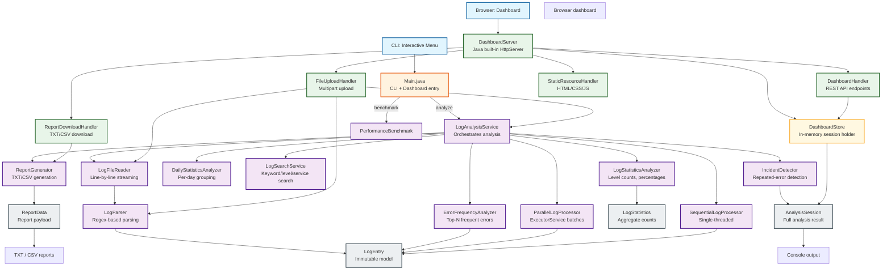

# LogSentinel – Intelligent Java Log Analyzer & Incident Detection System

A command-line and web-based Core Java application that reads application log files and analyzes them for errors, warnings, frequent issues, daily statistics, and repeated-error incidents. Includes a browser-based monitoring dashboard for real-time log exploration.

Built as a learning and interview-preparation project. No frameworks, no databases, no external dependencies — just Core Java.

```
mvn clean test  -> 104 tests pass, BUILD SUCCESS
mvn clean package -> BUILD SUCCESS, jar produced
```

---

## Project Overview

LogSentinel helps developers and support engineers understand application log files without setting up a logging stack:

- How many errors and warnings occurred?
- Which errors happen most frequently?
- At what times did errors happen?
- Which dates had the highest error count?
- Are errors repeating in suspicious patterns (possible incidents)?
- Can I search logs by keyword, level, service, or date?

LogSentinel answers these questions locally from `.log` and `.txt` files, with both a command-line interface and a browser-based dashboard.

---

## Dashboard Preview

LogSentinel includes a dark-themed, browser-based monitoring dashboard accessible at `http://localhost:8080` when started in dashboard mode. The dashboard reuses the same Core Java analysis engine as the CLI.

**Dashboard sections:**

| Section | Description |
|---------|-------------|
| Overview | Metric cards for total entries, log-level counts, and detected incidents |
| Log Analytics | Log level distribution charts and daily activity statistics |
| Error Monitoring | Most frequent errors ranked by occurrence count |
| Incident Detection | Potential incidents from repeated error patterns |
| Log Explorer | Searchable, filterable table of all parsed log entries |
| Upload Log | Drag-and-drop file upload for analysis |
| Reports | Download TXT and CSV analysis reports |

**Screenshots**

Genuine screenshots of the running dashboard are captured in `docs/screenshots/`. To capture them yourself:

1. Start the dashboard: `java -cp target/classes com.logsentinel.web.DashboardServer`
2. Upload a sample log file via the dashboard
3. Take screenshots at `http://localhost:8080` for each section

> **Note:** Automated browser screenshot capture was not available in this build environment. Screenshots should be captured manually by running the application and using your OS screenshot tool.

---

## Key Features

1. **Log file reader** — streams `.log`/`.txt` files with `BufferedReader`, tracks valid/invalid line counts, handles missing files and permission errors
2. **Log parser** — regex-based parser for timestamp, level, service, thread, message, and exception name. Degrades gracefully on malformed lines
3. **Log level statistics** — counts TRACE, DEBUG, INFO, WARN, ERROR, FATAL, UNKNOWN with percentages
4. **Error frequency analysis** — top-N most frequent errors, sorted, with associated service
5. **Date and keyword analysis** — daily error/warning totals, busiest day, busiest one-hour error window, keyword/level/service/date search
6. **Repeated error & incident detection** — configurable threshold and time window; flags potential incidents (e.g. 5+ similar errors within 1 minute) with IDs, severity, first/last occurrence
7. **Multithreaded processing** — optional `ExecutorService`-based parallel mode with bounded batches; sequential vs parallel results verified to match
8. **Report generation** — summary, error frequency, daily statistics, and incident reports in text and CSV (with proper CSV escaping)
9. **Performance benchmarking** — generates deterministic sample files and measures sequential vs parallel throughput with `System.nanoTime()`
10. **Interactive CLI menu** — validated input, readable aligned output, clean exit
11. **Web dashboard** — browser-based monitoring interface using built-in `HttpServer`, REST API, vanilla HTML/CSS/JS frontend
12. **File upload** — drag-and-drop log file upload via the dashboard with analysis results displayed immediately

---

## Technology Stack

- Java 17 (Core Java)
- Java Collections Framework (HashMap, ArrayList, HashSet, TreeMap, EnumMap)
- File I/O & NIO (`BufferedReader`, `BufferedWriter`, `Files`, `Paths`)
- Regular Expressions
- Java Streams API & Lambda Expressions
- Java Date and Time API (`java.time`)
- Multithreading & `ExecutorService`
- Java built-in `HttpServer` (web dashboard, no external framework)
- Exception Handling (custom exceptions where they add clarity)
- Immutable data models
- JUnit 5 (testing only)
- Maven (build tool)
- HTML5 / CSS3 / Vanilla JavaScript (dashboard frontend)

**Not used:** Spring, Spring Boot, Hibernate, JPA, MySQL, PostgreSQL, MongoDB, React, Angular, Node.js, Python, external logging frameworks, cloud services, external APIs, paid libraries.

The application runs locally without internet access after dependencies are downloaded.

---

## Architecture

### Architecture Diagram



### Application Workflow

```
1. User starts the application (CLI or --dashboard mode)
2. For CLI: User selects an option from the interactive menu
3. For Dashboard: Browser loads http://localhost:8080
4. User uploads a .log or .txt file (max 50 MB)
5. LogFileReader streams the file line-by-line
6. LogParser parses each line: timestamp, level, service, thread, message
7. Analysis engine computes: level counts, error frequency, daily stats, incidents
8. Results are stored in AnalysisSession (in-memory)
9. Dashboard renders metrics, charts, tables; or CLI prints output
10. User can download TXT/CSV reports or search/filter log entries
```

### Project Structure


### Key Design Decisions

- **Immutable models**: `LogEntry`, `LogStatistics`, `ErrorFrequency`, `DailyStat`, `Incident` are immutable
- **No static mutable state**: Incident IDs generated by instance-level counter in `IncidentDetector`
- **Streaming file read**: `LogFileReader` reads line-by-line; never loads the whole file into memory
- **No arbitrary file splitting**: parallel processing batches complete lines; aggregation after workers finish (no race conditions)
- **Dashboard state**: `DashboardStore` holds the latest `AnalysisSession` in memory with synchronized access
- **Incidents are potential, not confirmed**: the tool flags suspicious repetition only; it does not claim to identify root causes

---

## Installation Requirements

- Java 17 or later (JDK)
- Apache Maven 3.x

---

## How to Run the CLI

```powershell
cd C:\LogSentinel
mvn clean compile
java -cp target/classes com.logsentinel.Main
```

Or using Maven:

```powershell
mvn -q exec:java -Dexec.mainClass="com.logsentinel.Main"
```

The CLI displays an interactive menu:

```
1. Analyze a log file
2. View log level statistics
3. Find most frequent errors
4. Search logs by keyword
5. View daily error statistics
6. Detect repeated errors
7. Generate analysis reports
8. Run performance benchmark
9. Exit
```

---

## How to Start the Web Dashboard

```powershell
cd C:\LogSentinel
mvn clean package
java -cp target/classes com.logsentinel.Main --dashboard
```

Or with a custom port:

```powershell
java -cp target/classes com.logsentinel.Main --dashboard --port 9090
```

Or using the PORT environment variable:

```powershell
$env:PORT=9090; java -cp target/classes com.logsentinel.Main --dashboard
```

Then open your browser to:

```
http://localhost:8080
```

The CLI and dashboard share the same analysis engine. The CLI is unchanged — `--dashboard` is an additional mode.

---

## How to Upload Log Files

1. Start the dashboard server
2. Open `http://localhost:8080` in your browser
3. Navigate to the "Upload Log" section
4. Drag and drop a `.log` or `.txt` file, or click to browse
5. The file is analyzed immediately and results appear across all dashboard sections

**Constraints:**
- Supported extensions: `.log`, `.txt`
- Maximum file size: 50 MB
- Files are processed using the same streaming reader as the CLI (line-by-line, not loaded entirely into memory)

---

## How to Generate Reports

Reports can be generated in two ways:

**Via CLI (option 7):**
```
Enter reports output directory [reports/]: reports
Reports generated in: reports
```

**Via Dashboard:**
1. Upload a log file
2. Navigate to the "Reports" section
3. Click "Download TXT Report" or "Download CSV Report"

Reports include: input file name, processing timestamp, total/valid/invalid lines, log-level counts, most frequent errors, daily statistics, detected incidents, and processing duration.

Sample reports are in `docs/sample-reports/`.

---

## Sample Log Data

Four sample log files are in `sample-logs/`:

| File | Description |
|------|-------------|
| `application-demo.log` | General application logs with all log levels |
| `authentication-demo.log` | Auth-focused logs with failed logins and account lockouts |
| `database-demo.log` | Database-focused logs with connection timeouts and slow queries |
| `mixed-severity-demo.log` | Mixed severity with repeated errors, FATAL, and recovery messages |

All samples follow the parser's supported format:

```
2026-11-23 10:30:45 INFO [AuthService] User login successful
2026-11-23 10:31:12 WARN [PaymentService] Payment response delayed
2026-11-23 10:32:01 ERROR [DatabaseService] Connection timeout
```

---

## API Endpoints

| Endpoint | Method | Description |
|----------|--------|-------------|
| `GET /api/health` | GET | Service health check |
| `GET /api/dashboard` | GET | Full dashboard data (levels, daily stats, errors, incidents) |
| `GET /api/logs` | GET | Log entries (query params: `level`, `keyword`) |
| `GET /api/errors` | GET | Most frequent errors |
| `GET /api/incidents` | GET | Detected incidents |
| `POST /api/upload` | POST | Upload and analyze a log file (multipart/form-data) |
| `GET /api/reports/download?type=txt\|csv` | GET | Download analysis report |

All API responses are JSON.

---

## Testing

Run all automated tests:

```powershell
cd C:\LogSentinel
mvn clean test
```

Result: **104 tests, 0 failures, BUILD SUCCESS.**

Tests cover: valid/invalid parsing, missing/empty files, level counting, error frequency, date grouping, keyword search, incident detection, time-window boundaries, sequential/parallel consistency, report generation, CSV escaping, dashboard API, empty datasets, special characters, Unicode, and error monitoring.

Package the jar:

```powershell
mvn clean package
```

---

## Performance Benchmarking

Run the benchmark:

```powershell
cd C:\LogSentinel
java -cp target/classes com.logsentinel.benchmark.PerformanceBenchmark
```

Generates deterministic sample files (1/10/50/100 MB) and measures sequential vs parallel throughput using `System.nanoTime()`. Results are actual measurements — no numbers are hardcoded or invented.

---

## Docker Deployment

A multi-stage Dockerfile is provided for container deployment (e.g. Vercel Container Deployment):

```dockerfile
FROM maven:3.9-eclipse-temurin-17 AS build
WORKDIR /workspace
COPY pom.xml .
COPY src ./src
RUN mvn clean package -DskipTests

FROM eclipse-temurin:17-jre
WORKDIR /app
COPY --from=build /workspace/target/logsentinel-1.0.0.jar app.jar
EXPOSE 8080
ENV PORT=8080
ENTRYPOINT ["java", "-jar", "app.jar", "--dashboard"]
```

Build and run locally:

```powershell
docker build -f Dockerfile.vercel -t logsentinel:vercel .
docker run -p 8080:8080 -e PORT=8080 logsentinel:vercel
```

The server binds to `0.0.0.0` and reads the port from the `PORT` environment variable (default: 8080). It handles SIGTERM for graceful shutdown.

---

## Vercel Container Deployment

The project is deployed on Vercel Container Deployment using `Dockerfile.vercel`.

### Production URL

- **Public dashboard**: https://logsentinel-three.vercel.app
- **Health endpoint**: https://logsentinel-three.vercel.app/api/health

### Deploy to Vercel

1. Install the Vercel CLI: `npm install -g vercel`
2. Log in: `vercel login`
3. From the project directory: `vercel --prod`
4. The production URL will be provided after deployment.

### Important Deployment Steps

After deploying via the CLI, you must also:

1. **Enable Container Deployment** in the Vercel dashboard:
   - Go to https://vercel.com/dashboard → select your project → Settings → General
   - Enable "Container Deployment" (or the equivalent framework preset for Docker)
2. **Disable deployment protection** (to make the URL publicly accessible):
   - Vercel CLI: `vercel project protection disable --sso --yes`

### Deployment Notes

- The Docker build uses Eclipse Temurin JDK 17 for the build stage and Eclipse Temurin JRE 17 for the runtime stage.
- The executable JAR (`logsentinel-1.0.0.jar`) is copied into the runtime image as `app.jar`.
- The application starts with `java -jar app.jar --dashboard`.
- Vercel provides the `PORT` environment variable at runtime; the server reads it and binds to `0.0.0.0`.
- Dashboard state (`AnalysisSession`) is held in memory per container instance. Container restarts clear the session. No external database is used.
- Docker image could not be built locally during this audit (Docker daemon not available on the build machine). Container execution remains unverified locally but the Dockerfile follows standard multi-stage best practices.

---

## Security Considerations

- File uploads are validated for extension (`.log`, `.txt` only) and size (max 50 MB)
- Uploaded filenames are sanitized to prevent path traversal
- Files are stored in a temporary directory and deleted after processing
- No execution of uploaded file contents
- No arbitrary filesystem access via API endpoints
- The dashboard server binds to 0.0.0.0 and reads the port from the PORT environment variable
- Error responses do not expose internal exception details

---

## Current Limitations

- Incident detection requires valid timestamps; errors without timestamps are excluded from time-window analysis
- Incident detection flags suspicious repetition only — not confirmed root causes
- Dashboard stores the latest analysis session in memory per container instance; container restarts clear it
- Parallel processing uses bounded in-memory batches; extremely wide lines could increase per-batch memory
- The dashboard is single-user (one session at a time)
- Session data is not shared across multiple container instances (e.g. when scaled on Vercel)
- Screenshots must be captured manually (no browser automation tool in this build environment)

---

## Future Improvements

- Export incidents to JSON
- Configurable parser format via properties file
- Multi-user dashboard with session isolation
- Log file tailing / watch mode
- Compare multiple files side by side
- Email/webhook alerts for critical incidents

---

## Author & Repository

- GitHub: https://github.com/Hhari1234/LogSentinel
- This is an educational log analysis and monitoring project, not a replacement for enterprise observability systems.

---

## GitHub Upload

```powershell
cd C:\LogSentinel
git init
git add .
git commit -m "Build LogSentinel Core Java log analyzer"
git branch -M main
git remote add origin https://github.com/Hhari1234/LogSentinel.git
git push -u origin main
```

Generated files under `reports/`, `benchmarks/`, `target/`, and `docs/screenshots/` are handled by `.gitignore` — sample demo logs (`*-demo.log`) are tracked, but generated large logs are not.
